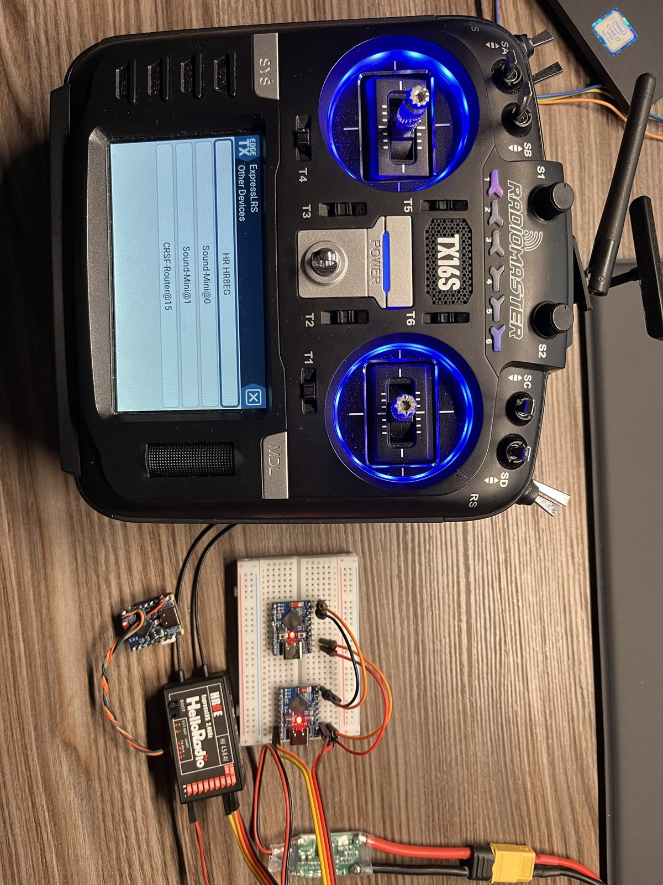

# RC-CRSF-Router-ESP32-S3

CRSF-Verteiler für ELRS-Empfänger auf einem **ESP32-S3-Zero**. Der Router hängt an einem freien CRSF-Port des Empfängers und verteilt CRSF auf zwei weitere Ports (Port B und Port C). So lassen sich mehrere Module an einem Empfänger betreiben und verketten: RC-Multiswitch C3/S3, Multiswitch Basis (Ziege-One), Soundmodule, G030-Multiswitch und weitere Router.

> **Stand:** Firmware v0.3.6 (Adresskonflikt blau, Port im Lua/WebUI) als fertiger Arduino-Sketch auf Basis von **RC_Common 1.2.1** (`firmware/RC_CRSF_Router/`). Gebaut über GitHub Actions; Port A und Telemetrie am 04.11.2026 auf Hardware getestet. Das erste Gerüst v0.2.0 liegt zum Vergleich in `firmware/v0.2.0-geruest/`.

*Testaufbau 05.11.2026: ELRS-Empfänger, S3-Router und zwei Sound-Minis. Der Sender (TX16S) zeigt unter „Other Devices“ den Router „CRSF-Router@15“ und die Module „Sound-Mini@0“ und „Sound-Mini@1“ hinter ihm.*

## Funktionen (v0.3.6)

- Weiterleitung Empfänger → Port B/C und zurück, Ketten über mehrere Stufen (RC_Common-Router). Nach unten geht alles außer Anfragen an die eigene Adresse, nach oben alles, zwischen B und C nie.
- Jeder Port wählbar: Aus / CRSF / S.Port / GPS / Raw (Lua und WebUI), gilt nach Neustart
- Eigene WM-Moduladresse 0–15 (Vorgabe 15 = 0xCF), mehrere Router im Modell möglich, Warnung bei doppelter Adresse
- Status-LED in Farben (siehe unten)
- Telemetrie: Empfängerspannung (als RxBt oder Zellen-Wert), Temperatur des ESP32, FLVSS über S.Port, GPS
- Lua-Menü am Sender: Ports, Adresse, Telemetrie, Zähler, WLAN, Neustart
- WebUI: Status, Ports, Telemetrie, WLAN, Backups im Modul, Export/Import, Firmware-Update (OTA)

Geplant für später: Geräteliste und Telemetrie-Übersicht über den ganzen Baum (RC_Common 1.3.0), Telemetrie-Bremse, Parameter-Browser in der WebUI.

## Status-LED

| LED | Bedeutung |
|---|---|
| grün langsam | RC-Signal in Ordnung |
| violett langsam | RC-Signal in Ordnung, WLAN an |
| rot schnell | kein RC-Signal / Failsafe |
| violett schnell | kein RC-Signal, WLAN an |
| blau Doppelblitz | Adresskonflikt: ein Gerät an Port B oder C hat dieselbe Adresse (ab v0.3.6; Lua „Status“ → „Adresskonflikt“ zeigt den Port). Adresse ändern, dann Neustart. |
| gelb Doppelblitz | doppelte Port-Rolle |
| blau blinkend (3 s nach dem Start) | jetzt BOOT drücken = WLAN an |

Beim ESP32-S3-Zero sind Rot und Grün in der LED vertauscht. Die Vorgabe „LED Reihenfolge: RGB (S3-Zero)“ im Lua-Menü gleicht das aus; bei einem Board mit Standard-WS2812 dort „GRB“ wählen.

## WLAN

Access Point **CRSF-Router**, Passwort `123456789`, Seite http://192.168.1.1. Einschalten über BOOT-Taste (3 s nach dem Start drücken oder im Betrieb jederzeit 2 s halten, das schaltet auch wieder aus), Lua „WLAN jetzt“, automatisch nach 60 s ohne RC-Signal oder „WLAN dauerhaft an“ (Vorgabe aus).

## Firmware flashen

Es gibt drei Wege. Ein neues Modul wird einmal per USB geflasht (Weg 1 oder Weg 2), danach geht jedes Update bequem per WLAN (Weg 3).

| Weg | Braucht | Einstellungen im Modul |
|---|---|---|
| 1. Fertige Datei aus GitHub + Web-Flasher | nur Chrome oder Edge | werden **gelöscht** |
| 2. Arduino IDE | Arduino IDE 2.x | bleiben erhalten |
| 3. Update per WLAN | Handy oder PC mit WLAN | bleiben erhalten |

### Weg 1: Fertige Firmware aus GitHub (ohne Arduino IDE)

GitHub baut die Firmware bei jeder Änderung automatisch (Workflow „Firmware bauen“).

1. Auf GitHub angemeldet sein (sonst gibt es keinen Download-Knopf).
2. In diesem Repo oben auf **Actions** klicken, links den Workflow **Firmware bauen** wählen.
3. Den obersten Lauf mit grünem Haken öffnen (Branch `main`).
4. Ganz unten unter **Artifacts** **crsf-router-s3-firmware** herunterladen und die ZIP-Datei entpacken. Darin liegen u. a. `RC_CRSF_Router.ino.merged.bin` (Komplett-Image für USB) und `RC_CRSF_Router.ino.bin` (nur für Weg 3).
   Steht dort nichts (Artefakte werden nach 90 Tagen gelöscht): rechts oben **Run workflow** → **Run workflow** klicken, nach ca. 3 Minuten ist ein neuer Lauf fertig.
5. ESP32-S3-Zero mit einem USB-C-**Datenkabel** an den PC stecken (kein reines Ladekabel). Ein Treiber ist unter Windows 10/11 nicht nötig.
6. In **Chrome** oder **Edge** die Seite https://espressif.github.io/esptool-js/ öffnen (Espressif-Web-Flasher, Firefox geht nicht).
7. **Connect** klicken und den COM-Port des Moduls wählen. Klappt das nicht: Baudrate oben auf `115200` stellen und das Modul mit der BOOT-Taste in den Flash-Modus bringen (siehe Weg 2, „Wenn das Hochladen nicht klappt“).
8. Unter **Flash Address** `0x0` eintragen, mit **Datei auswählen** die `.merged.bin` wählen, dann **Program** klicken.
9. Wenn unten „Leaving…“ steht, das USB-Kabel kurz abziehen und wieder einstecken. Fertig.

> **Achtung:** Das Komplett-Image überschreibt den ganzen Flash (4 MB). Alle Einstellungen und Backups im Modul sind danach weg. Vorher in der Weboberfläche die Einstellungen als Datei sichern (Karte **Einstellungen sichern** → „Export als Datei“) und hinterher dort wieder importieren. Wer die Einstellungen behalten will, nimmt Weg 2 oder 3.

### Weg 2: Arduino IDE

**Einmalig einrichten**

1. Arduino IDE 2.x installieren (https://www.arduino.cc/en/software).
2. **Datei → Einstellungen → Zusätzliche Boardverwalter-URLs**: `https://espressif.github.io/arduino-esp32/package_esp32_index.json` eintragen.
3. **Werkzeuge → Board → Boardverwalter**: „esp32“ suchen, **esp32 von Espressif Systems** in Version **3.0.7** installieren.
4. **Werkzeuge → Bibliotheken verwalten**: **TinyGPSPlus 1.0.3** suchen und in genau dieser Version installieren.
   Alles andere (z. B. `src/RC_Common/`) liegt schon im Sketch-Ordner.

**Flashen**

1. Repo herunterladen: oben auf GitHub **Code → Download ZIP**, entpacken (oder den vorhandenen Ordner nehmen).
2. In der Arduino IDE **Datei → Öffnen** und `firmware/RC_CRSF_Router/RC_CRSF_Router.ino` wählen.
3. Unter **Werkzeuge** einstellen:

   | Einstellung | Wert |
   |---|---|
   | Board | **ESP32S3 Dev Module** |
   | USB CDC On Boot | **Enabled** |
   | USB Mode | Hardware CDC and JTAG |
   | Flash Size | **4MB (32Mb)** |
   | Partition Scheme | **Default 4MB with spiffs (1.2MB APP/1.5MB SPIFFS)** |
   | PSRAM | Disabled |
   | Erase All Flash Before Sketch Upload | **Disabled** (sonst sind die Einstellungen weg) |

4. ESP32-S3-Zero mit einem USB-C-**Datenkabel** an den PC stecken (kein reines Ladekabel). Ein Treiber ist unter Windows 10/11 nicht nötig. Dann unter **Werkzeuge → Port** den neuen COM-Port wählen.
5. Auf den Pfeil **Hochladen** klicken. Am Ende steht „Hard resetting via RTS pin…“.
6. Das Modul startet von selbst neu. Wenn nicht: USB-Kabel kurz abziehen und wieder einstecken.

**Wenn das Hochladen nicht klappt** („Failed to connect“ oder „No serial data received“): USB abziehen, die Taste **BOOT** gedrückt halten, USB wieder einstecken, BOOT loslassen. Das Modul ist jetzt im Flash-Modus. Unter **Werkzeuge → Port** ggf. den neuen COM-Port wählen und noch einmal **Hochladen**. Danach das USB-Kabel einmal abziehen und wieder einstecken.

### Weg 3: Update per WLAN (OTA)

1. Die Datei `RC_CRSF_Router.ino.bin` besorgen: aus GitHub (Weg 1, Schritte 1–4) oder in der Arduino IDE mit **Sketch → Kompilierte Binärdatei exportieren** (liegt dann im Sketch-Ordner unter `build/`). Nicht die `.merged.bin` nehmen.
2. WLAN des Routers einschalten: BOOT-Taste im Betrieb 2 s halten (oder Lua „WLAN jetzt“, siehe [WLAN](#wlan)). Name **CRSF-Router**, Passwort `123456789`.
3. Mit Handy oder PC in dieses WLAN gehen und im Browser http://192.168.1.1 öffnen.
4. Karte **Firmware-Update**: die `.bin`-Datei auswählen und hochladen. Das Modul startet danach neu, die Einstellungen bleiben erhalten.

Schlägt das Update fehl, läuft die alte Firmware einfach weiter. Das Modul beim Update am besten über den Empfänger/BEC versorgen, nicht nur über einen schwachen USB-Anschluss.

## Pins (S3-Zero)

| Funktion | Pins |
|---|---|
| Port A: Eingang vom Empfänger (CRSF) | RX 44, TX 43 (Pins „RX“/„TX“ rechts oben) |
| Port B | RX 5, TX 6 |
| Port C | RX 7, TX 8 |
| Status-LED | GPIO21 |
| Empfängerspannung | GPIO1 über Teiler 33 kΩ / 10 kΩ |

**Fehlersuche Eingang:** Im seriellen Monitor (USB, 115200) steht alle 2 s, wie viele Bytes, gültige Frames und CRC-Fehler an Port A ankommen; dasselbe zeigt die WebUI unter Status. Bytes = 0 heißt: am RX-Pin kommt nichts an (Kabel/Pin). Bytes steigen, aber keine Frames: falsche Baudrate oder Störung.

Alle Ports vollduplex. Rolle (Aus/CRSF/S.Port/GPS/Raw) und Baudrate von Port B und C werden im Lua-Menü (Ordner „Ports“) oder in der WebUI eingestellt und gelten nach einem Neustart. S.Port wird extern mit einer Diode (1N4148) auf eine Leitung gebracht.

## Aufbau des Repos

| Ordner | Inhalt |
|---|---|
| `firmware/` | Firmware (Gerüst v0.2.0, später Arduino-Sketch) |
| `hardware/` | Schaltplan und Platine (folgt) |
| `docs/` | Projektbeschreibung (`PROJEKT.md`), später Abnahmeprüfung |

## Verwandte Projekte

- [RC-Multiswitch-ESP32-S3](https://github.com/mnorden81/RC-Multiswitch-ESP32-S3) / [-C3](https://github.com/mnorden81/RC-Multiswitch-ESP32-C3)
- [ESP32-Sound-Mini-S3](https://github.com/mnorden81/ESP32-Sound-Mini-S3)
- [ESP32-Multiswitch-Basis_Ziege-One](https://github.com/mnorden81/ESP32-Multiswitch-Basis_Ziege-One)
- [rcmultiswitchG030_eigen](https://github.com/mnorden81/rcmultiswitchG030_eigen)
